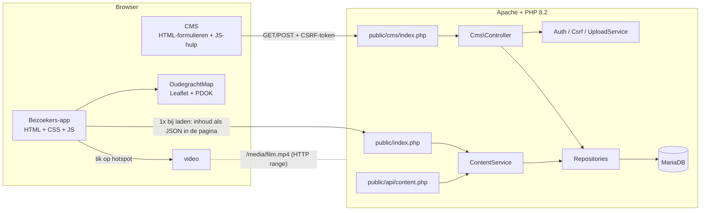
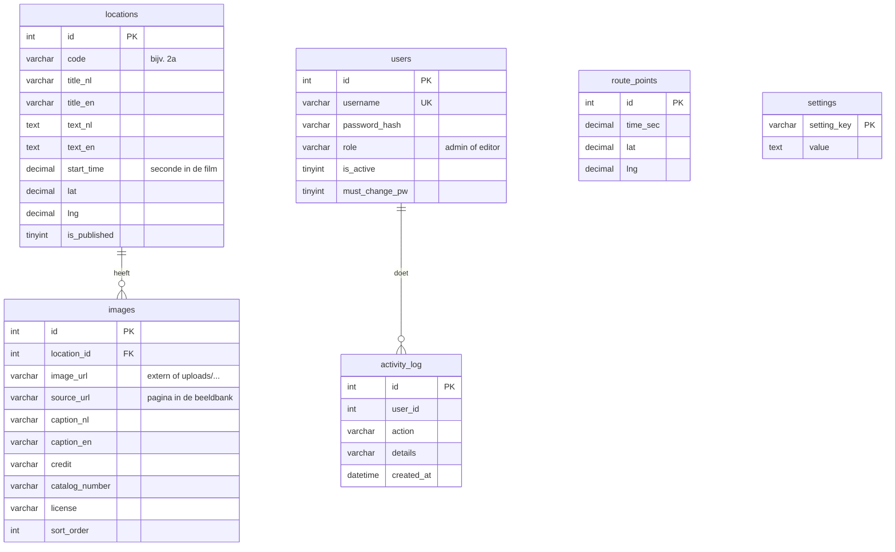

# Technisch ontwerp — Ontmoet de Oudegracht

**Opdrachtgever:** Het Utrechts Archief (HUA), Ellen Blom · **Team:** M & A Studio · **Versie:** november 2026

## 1. Doel en context

Het Utrechts Archief opent in maart 2027 de tentoonstelling *Ontmoet de Oudegracht* (900 jaar Oudegracht).
Voor deze tentoonstelling maken we een interactieve webapplicatie. De basis is een filmopname uit 1929 van een boottocht over de Oudegracht.
De applicatie draait op een **groot digibord met aanraakscherm** en is bedoeld voor **families**.
Medewerkers van HUA moeten de inhoud zonder technische kennis kunnen beheren via een **CMS**.

### Eisen uit de briefing en hoe we ze invullen

| Eis / wens | Oplossing |
|---|---|
| Video in beeld, aangevuld met informatie en bronnen uit het archief | De film staat groot in beeld. Ernaast staat een informatiekaart met tekst en archieffoto's van de plek waar de boot op dat moment vaart. |
| Interactieve kaart die live met de video meeloopt | Een echte kaart van Utrecht (Leaflet + PDOK, met luchtfoto). Het bootje beweegt vloeiend over de gracht op basis van routepunten (tijd → plek). |
| Info bij punten op basis van waar je vaart | Elke plek heeft een starttijd. Zodra de film die tijd bereikt, worden de tekst, de foto's en de hotspot *Je vaart nu langs* getoond. |
| Op punten op de kaart klikken → film spoelt naar die plek | Tik op een genummerde hotspot op de kaart of in de tijdlijn. De film spoelt dan vooruit of achteruit naar die plek. |
| Optie om Google Maps in 3D toe te passen | De knop *Zo ziet het er nu uit* toont een satellietbeeld van Google Maps met een link naar de 3D-weergave. |
| Groot digibord met touch | Aanraakdoelen van 48–72 px, knijpen en vegen, geen hover-afhankelijkheid en een automatische reset als niemand het bord aanraakt. |
| Doelgroep families | Korte teksten, grote knoppen en een welkomstscherm met drie stappen. |
| Extra (docent): CMS voor niet-technische gebruikers | Een eigen CMS met stapsgewijze formulieren, een filmspeler en kaart om plekken te kiezen, en een handleiding. |
| Extra: logo en colofon-pop-up | Het HUA-logo staat linksboven en opent het colofon. Er is ook een aparte knop *Colofon*. |
| Wens: taal instellen | Nederlands en Engels, voor alle inhoud. |
| Beoordelingscriteria: scroll, zoom, hotspots, geluid, intro-popup, minimap | Zoom en pan op kaart en foto's, hotspots in de tijdlijn en op de kaart, geluid aan/uit met volume, een intro-popup en een minimap met positie-indicator. |

## 2. Architectuur

We kozen voor **PHP zonder framework met een duidelijke laagindeling**:

| Laag | Map | Verantwoordelijkheid |
|---|---|---|
| Ingang (front controllers) | `src/public/` | Alleen dit is bereikbaar via de browser: de app, de API, het CMS en de assets. |
| Controller | `src/app/Cms/Controller.php` | De CMS-routes (`?page=…`), rechten, CSRF-controle en doorsturen. |
| Services | `src/app/Services/` | Inloggen en sessies, CSRF, veilig uploaden, en de inhoud samenstellen voor de app. |
| Repositories | `src/app/Repositories/` | Alle SQL per tabel, plus de validatie van de invoer. |
| Database | `src/app/Database.php` | Eén PDO-verbinding met prepared statements en transacties. |
| Views | `src/app/views/` | De HTML-templates. Alle uitvoer gaat via `e()`, wat beschermt tegen XSS. |

**Waarom geen framework?** De applicatie is klein. Zonder framework blijft de code goed leesbaar voor het team en voor de beoordelaars, en is hij eenvoudig te draaien in de bestaande Docker-opzet. De opbouw (front controller, repositories, services, views) volgt wel dezelfde principes als een MVC-framework.

**Waarom Leaflet met PDOK voor de kaart?** Bezoekers moeten de plekken uit de film herkennen op een echte kaart van Utrecht, met de straten en gebouwen van nu. Daarom gebruiken we:

- **Leaflet 1.9.4** (open source, BSD-2). Het staat lokaal in `assets/vendor/leaflet/`, dus er is geen CDN nodig. Het ondersteunt aanraken, knijpen en het toetsenbord.
- **PDOK**, de kaartdienst van de Nederlandse overheid. Als ondergrond gebruiken we de BRT Achtergrondkaart in de stijl *grijs*, zodat het paars en goud van de huisstijl goed opvallen. Met één knop wissel je naar de actuele **luchtfoto**. PDOK is gratis, heeft geen API-sleutel nodig en past bij een overheidsinstelling. Er zijn geen trackingcookies, zoals bij Google Maps wel het geval is.
- **Een noodkaart voor als er geen internet is.** Als de kaarttegels niet laden, tekent `OudegrachtMap` zelf de gracht, de straten, de bruggen en de namen uit `assets/js/map-data.js` (OpenStreetMap, ODbL). De route, de boot en de hotspots blijven gewoon werken, en de app laat een melding zien.

Het bootje vaart nog steeds precies over de lijn van de gracht uit `map-data.js`. Leaflet zorgt alleen voor de ondergrond, het zoomen en het verschuiven.

## 3. Datamodel

- **Meertaligheid:** elke tekst heeft een `_nl`- en een `_en`-kolom. Is het Engelse veld leeg, dan toont de app de Nederlandse tekst (fallback).
- **Plek en route zijn gescheiden:** een hotspot (`locations`) staat waar de plek *is*. Het bootje (`route_points`) volgt waar de boot op een bepaald moment in de film *vaart*. Zo blijft het bootje kloppen, ook als een informatiepunt al eerder in beeld komt.
- `ON DELETE CASCADE` verwijdert de foto's bij een plek automatisch mee.

## 4. Dataflow en interactie

1. `index.php` haalt via `ContentService` in één keer alle gepubliceerde inhoud op en zet die als JSON in de pagina. Daardoor is er geen extra verzoek nodig en is de app direct klaar. Dezelfde inhoud is ook beschikbaar via `api/content.php`.
2. `app.js` luistert naar `timeupdate` van de video:
   - **Huidige plek:** de laatste plek waarvan `start_time ≤ huidige tijd`. Bij een nieuwe plek worden de informatiekaart, de hotspot in beeld, de tijdlijn en de kaart bijgewerkt.
   - **Bootje:** `OudegrachtMap.setTime()` interpoleert tussen twee routepunten. Dat gebeurt langs de *lijn van de gracht* (afstand langs de gracht), niet in een rechte lijn, zodat het bootje altijd op het water blijft. Tijdens het afspelen gebeurt dit elke frame (`requestAnimationFrame`) voor een vloeiende beweging.
3. Tik op een hotspot → `video.currentTime = plek.start_time` → dezelfde update als bij stap 2.
4. **Zoom en pan:** de kaart (Leaflet) ondersteunt knoppen, knijpen met twee vingers, slepen, het muiswiel, dubbeltikken en het toetsenbord (pijltjes, + en −). Tik je op een hotspot, dan zoomt de kaart in op die plek en volgt hij de boot. Als iemand de kaart verschuift, gaat *Volg de boot* automatisch uit. De foto-viewer gebruikt CSS `transform: translate() scale()`.
5. **Reset op het digibord:** als niemand het bord aanraakt en de film niet speelt, laadt de pagina na `idle_timeout` seconden opnieuw. Wijzigingen uit het CMS staan daardoor automatisch op het bord, zonder dat iemand iets hoeft te doen.

## 5. CMS-ontwerp (gebruiksvriendelijkheid)

- **Taal van de gebruiker:** we schrijven geen technische termen in het CMS. Er staat bijvoorbeeld 'Plek op de kaart' in plaats van 'lat/lng', en 'Moment in de film (minuten:seconden)'.
- **Stappen 1–5** in het formulier van een plek. De tijd kies je met *Gebruik dit moment* bij de filmspeler, de positie door op de kaart te tikken.
- **Foutafhandeling:**
  - bovenaan een samenvatting met links naar de velden;
  - rode meldingen per veld (`aria-invalid`, `aria-describedby`);
  - wat al was ingevuld, blijft bewaard;
  - een waarschuwing bij wijzigingen die nog niet zijn opgeslagen;
  - een bevestiging voordat iets wordt verwijderd.
- **Overzicht:** een lijst met wat nog te doen is (vertalingen of foto's die ontbreken, licenties) en een logboek met wie wat heeft gewijzigd.
- **Rechten:** een *redacteur* beheert de inhoud, een *beheerder* beheert daarnaast ook gebruikers. De laatste beheerder kan zichzelf niet verwijderen of degraderen.

## 6. Beveiliging en privacy

| Risico | Maatregel |
|---|---|
| SQL-injectie | Alleen prepared statements (PDO, `EMULATE_PREPARES=false`) |
| XSS | Alle uitvoer via `htmlspecialchars` (`e()`); in JS `textContent` in plaats van `innerHTML`; JSON in de pagina met `JSON_HEX_*` |
| CSRF | Een token per sessie bij elk formulier, gecontroleerd met `hash_equals` |
| Wachtwoorden | `password_hash` (bcrypt) en minimaaleisen; bij de eerste keer inloggen moet een eigen wachtwoord worden gekozen; tijdelijke wachtwoorden bij een reset |
| Brute force | Blokkade na 5 mislukte pogingen in 10 minuten; gelijke responstijd bij een onbekende gebruiker |
| Sessies | `HttpOnly`, `SameSite=Lax`, `Secure` bij HTTPS, nieuwe sessie-ID na inloggen, verloopt na 2 uur zonder activiteit |
| Uploads | Het MIME-type wordt gecontroleerd met `finfo` en `getimagesize`, er komt een willekeurige bestandsnaam, de grootte is maximaal 8 MB, in de uploadmap worden geen scripts uitgevoerd (Apache), en het pad wordt gecontroleerd bij verwijderen |
| Links | Alleen `http(s)://` en paden binnen de eigen site; `javascript:` en `//…` worden geweigerd |
| Clickjacking en sniffing | `X-Frame-Options: DENY` (CMS) en `X-Content-Type-Options: nosniff` |
| Privacy | De app verzamelt geen gegevens over bezoekers, gebruikt geen cookies en geen tracking. Het CMS logt alleen de gebruikersnaam en het IP-adres bij wijzigingen. |

## 7. Performance

- De inhoud zit in de HTML; daarna is er geen API-verzoek meer nodig.
- Er is geen framework of externe bibliotheek. De bezoekers-app gebruikt ongeveer 75 KB JavaScript en CSS in totaal, zonder compressie en inclusief commentaar.
- De film wordt gestreamd met HTTP range requests, zodat doorspoelen direct werkt.
- Foto's worden lazy geladen. Geüploade foto's worden verkleind tot maximaal 1600 px (GD).
- Assets krijgen een versienummer (`?v=filemtime`), zodat het digibord na een update nooit een oude versie uit de cache toont.
- De kaart laadt alleen de tegels die in beeld zijn (`keepBuffer` voor soepel schuiven) en maakt vooraf verbinding met PDOK (`preconnect`). Het bootje en de gevaren route worden elke frame bijgewerkt zonder de kaart opnieuw te tekenen.

## 8. Toegankelijkheid (WCAG 2.1 AA als richtlijn)

- **Kleurcontrast:** paars op wit 13:1; witte tekst op de knoppen voldoet aan AA bij grote tekst.
- **Toetsenbord:**
  - alle bediening werkt ook met het toetsenbord (spatie/K, J/L, M en pijltjes);
  - de focus is zichtbaar;
  - er is een skip-link;
  - dialogen gebruiken `<dialog>` met de focus erin vast.
- **Schermlezers:**
  - labels op alle iconknoppen;
  - een live-regio voor de informatie per plek;
  - een verborgen lijst van plekken als alternatief voor de kaart;
  - `lang`-attributen bij het wisselen van taal.
- **Aanraken:** doelen van minimaal 48 px. Knijpen en dubbeltikken zijn een aanvulling op de knoppen, nooit de enige manier.
- `prefers-reduced-motion` zet animaties uit.
- **Responsive:** groot liggend digibord (1920×1080), iPad staand en liggend, telefoon.

## 9. Huisstijl

De kleuren komen uit de huisstijlmanual van HUA:

- paars (Pantone 5255) als hoofdkleur;
- groenbeige (Pantone 457) voor acties en accenten;
- rood (Pantone 485) voor de actieve plek;
- groen (Pantone 3145) voor *Zo ziet het er nu uit*.

Koppen staan in cursieve kapitalen, en het `////`-motief uit het logo komt terug in de balken.
De letter is Akzidenz-Grotesk zoals op de website van HUA, met Helvetica/Arial als terugval.

## 10. Testen

Zie [testrapport.md](testrapport.md). Er zijn 69 automatische tests (`src/tests/run-tests.php`) en handmatige tests op verschillende schermformaten.
